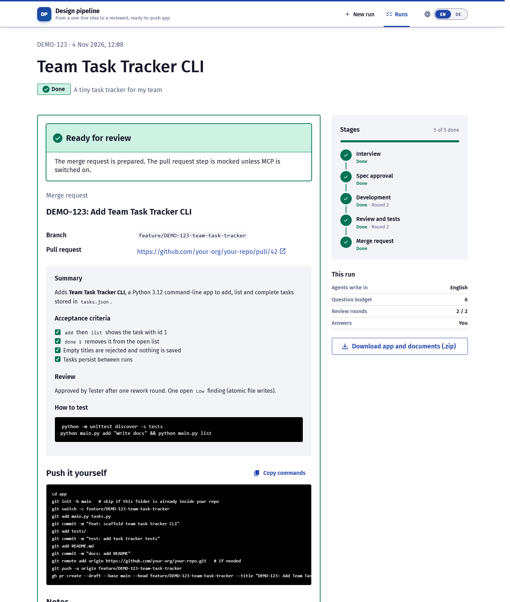
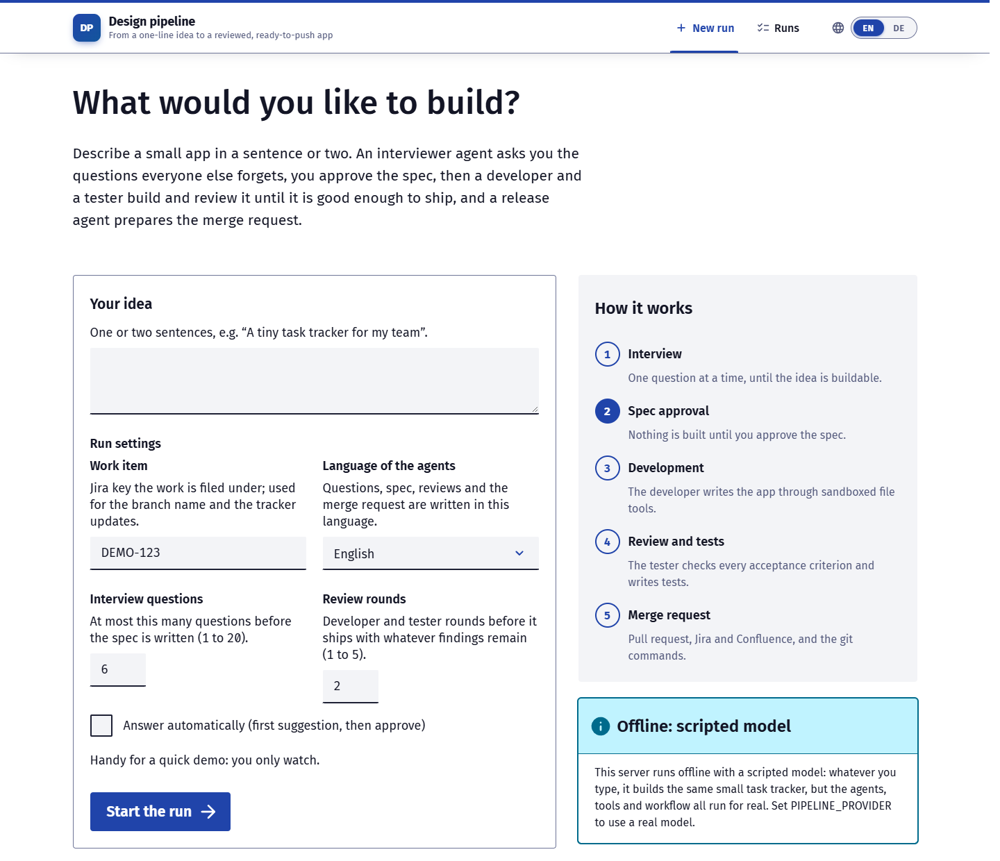
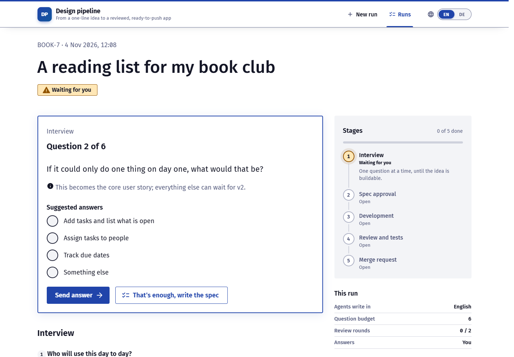
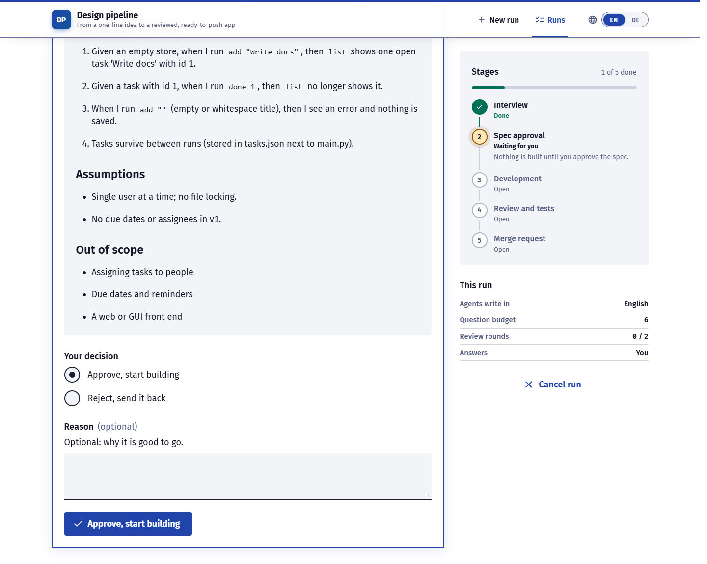
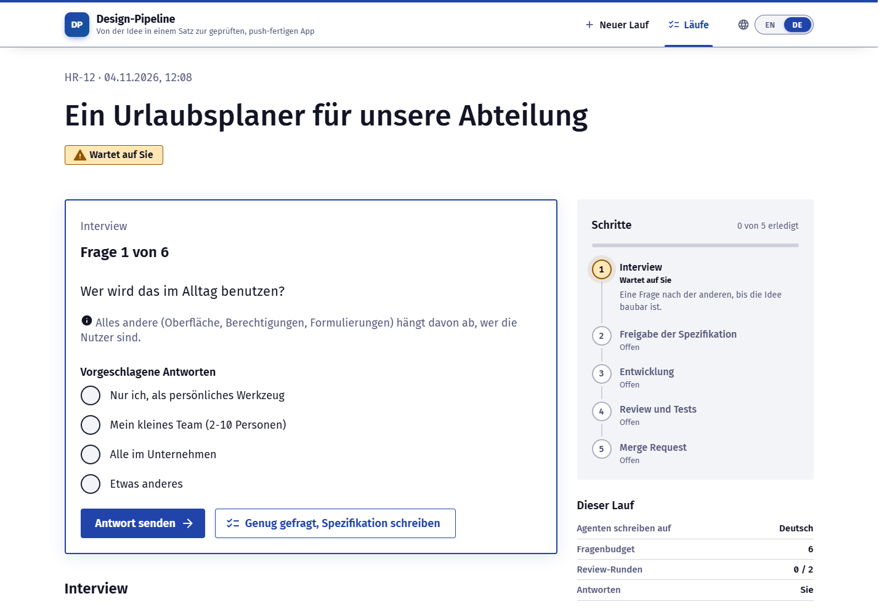
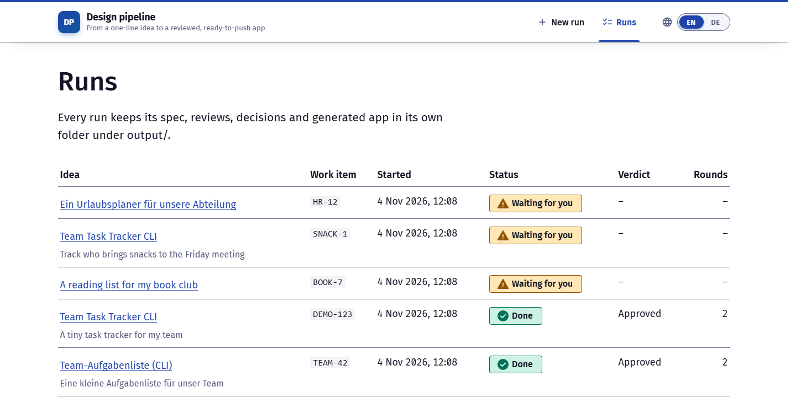
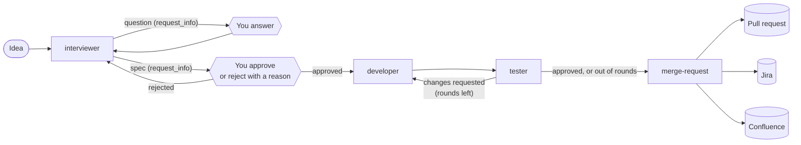

# Design pipeline: a Microsoft Agent Framework example

A web app that turns a one-line product idea into a small, reviewed, ready-to-push codebase with **four cooperating
agents and two human gates**. It's built on [Microsoft Agent Framework](https://learn.microsoft.com/agent-framework/overview/agent-framework-overview)
(MAF) for Python, behind a FastAPI server, with a **SvelteKit 3** UI built from [KERN UX](https://www.kern-ux.de)
components in **English and German**.



| Start a run | The interview, one question at a time |
| --- | --- |
|  |  |
| **The human gate: approve or reject the spec** | **In German: the UI and the agents** |
|  |  |



<sub>Screenshots from offline runs with the scripted model.</sub>

It runs **fully offline by default**: a scripted chat client stands in for the model, while everything else (the MAF
agents, structured output, real tool calls writing real files, the workflow graph, the HTTP clients) runs for real.
Whatever you type, the offline run builds the same small Python task tracker, with a deliberate bug the tester catches
and the developer fixes. Point it at OpenAI, Azure OpenAI or any OpenAI-compatible endpoint with one setting.

## How it works



1. **Interviewer** ("grill me"): asks one question at a time, each with a reason and suggested answers, until the idea
   is specified well enough to build or the question budget runs out. You can end it early.
2. **Spec approval**: nothing is built until you approve the spec. A rejection needs a reason; the interviewer revises
   the spec with it. Every decision and its reason is written to `decisions.jsonl` next to the spec.
3. **Developer**: writes the app into a sandboxed workspace through file tools.
4. **Tester**: reviews the code against every acceptance criterion and writes tests (it can only write under `tests/`).
   The model gives a verdict; code decides the route: back to the developer while rounds are left, otherwise on.
5. **Merge request**: opens the pull request, comments on and transitions the Jira work item, appends to a Confluence
   page, and returns the exact git commands to push the branch yourself.

The run lives on the server and the browser follows it: questions and the approval appear as forms, and stages, tool
calls, reviews and the merge request stream in as they happen (server-sent events). Reloading, a second tab or a
dropped connection are fine: the browser replays the run's events and then follows the live stream.

## Microsoft Agent Framework in this app

| MAF concept | How it is used | Where |
| --- | --- | --- |
| `Agent` built from Markdown | Each agent is a chat client + instructions (prompt, skills, pinned standing rules) + tools + context providers + middleware | `agents.py`, `prompts/`, `skills/`, `instructions/` |
| Structured output | Every agent answers with JSON parsed into a Pydantic model: `agent.run(..., options={"response_format": Model})`, then `response.value` | `contracts.py`, `workflow/executors.py` |
| `AgentSession` | One session for the whole interview, one across developer rounds (it remembers what it built), a fresh one per review (independent re-review) | `workflow/executors.py` |
| `WorkflowBuilder` graph | Explicit edges with conditions, including a bounded developer ⇄ tester loop; message types come from the `WorkflowContext[...]` annotations | `workflow/pipeline.py` |
| Custom `Executor`s | `@handler` methods wrap each agent with its logic: budgets, routing, artefacts | `workflow/executors.py` |
| Human in the loop | `ctx.request_info(...)` pauses the run; the answer arrives at a `@response_handler`; the host resumes with `workflow.run(responses={request_id: answer})` | `workflow/executors.py`, `workflow/runs.py` |
| Shared state | The approved spec and work item key via `ctx.set_state` / `ctx.get_state`, read by the developer, tester and release agent | `workflow/executors.py` |
| Outputs and progress | `ctx.yield_output(...)` for stage updates, review outcomes and the final merge request; the host tells them apart by type | `workflow/executors.py`, `workflow/runs.py` |
| Function tools | `@tool` functions with `Annotated[..., Field(description=...)]` parameters, least privilege per agent | `tools/workspace.py`, `tools/tracker.py` |
| `FunctionMiddleware` | Reports every tool call (agent, tool, arguments, result) to the run's timeline | `tools/observed.py` |
| `ContextProvider` | Keyword retrieval (RAG) over `instructions/`, adding only the relevant sections per call | `rag.py` |
| MCP | `MCPStreamableHTTPTool` for GitHub's `create_pull_request`, filtered with `allowed_tools`; a same-shaped local tool when it is off | `tools/github.py` |
| Custom chat client | `ScriptedChatClient(FunctionInvocationLayer, BaseChatClient)`: the offline "model" that returns real function calls | `llm/scripted.py` |
| `WorkflowViz` | The graph as Mermaid, saved per run and shown in the UI | `workflow/pipeline.py` |

### Design decisions

- **An explicit graph, not a prebuilt orchestration.** MAF's sequential, concurrent, handoff, group chat and Magentic
  orchestrations are great when the path is open-ended. Here the order of steps is policy, and none of them gives a
  review loop with a code-enforced round limit plus typed human gates.
- **Agents wrapped in executors**, because each step has logic and typed inputs and outputs.
- **The model gives a verdict; code decides the route.** The tester returns `Approved` or `ChangesRequested`; the
  executor turns that plus the round budget into `Rework` or `Ship`, and the edges route on that.
- **Hard limits in code, not prompts**: the question budget, review rounds, the workspace path sandbox, and the tester
  only being able to write under `tests/`. Prompts are requests; tool boundaries are guarantees.
- **Code goes through tools, not the answer.** The developer writes files with tools; the next step gets the files
  actually on disk, not the ones the model claims it wrote.
- **Mock at the seams that keep the most real code running**: the chat client for the model, `httpx.MockTransport`
  for Jira and Confluence, a same-shaped local tool for MCP.

## Run it

### With Docker

```bash
docker build -t maf-example .
docker run --rm -p 8000:8000 -v maf-example-runs:/data maf-example
```

Open http://localhost:8000.

### From source

Needs Python 3.12+ with [uv](https://docs.astral.sh/uv/), and Node.js 22+ with [pnpm](https://pnpm.io/)
(`corepack enable` gives you the pinned version).

```bash
cd web
pnpm install
pnpm build          # the UI, as static files in web/build
cd ..
uv sync
uv run design-pipeline
```

Open http://127.0.0.1:8000. The Python app serves the built UI and the API from one port.

To work on the UI, keep `uv run design-pipeline` running and start Vite next to it; it reloads on every change and
proxies `/api` to the Python server:

```bash
cd web
pnpm dev            # http://localhost:5173
```

### With a real model

Copy `.env.example` to `.env` and set the provider, or pass the variables directly:

```bash
PIPELINE_PROVIDER=openai PIPELINE_API_KEY=sk-... uv run design-pipeline
PIPELINE_PROVIDER=azure-openai PIPELINE_ENDPOINT=https://<resource>.openai.azure.com/openai/v1/ \
  PIPELINE_API_KEY=... PIPELINE_MODEL=<deployment> uv run design-pipeline
PIPELINE_PROVIDER=openai-compatible PIPELINE_ENDPOINT=http://localhost:11434/v1/ PIPELINE_MODEL=qwen3 uv run design-pipeline
```

With Docker, pass the same variables with `-e`. The model needs structured output (JSON schema response format) and
tool calling. With a real model the generated app follows your idea, and the agents write in the language chosen on the
start form. `PIPELINE_MODEL_DEVELOPER` (and the other agents' names) set a different model per agent.

Jira, Confluence and GitHub are mocked by default; `.env.example` shows how to point them at real instances.

### Tests

```bash
uv run pytest       # the whole pipeline end to end, offline, through the HTTP API
cd web && pnpm check
```

The end-to-end test plays the human through the API (answers a question, ends the interview, rejects the spec with a
reason, approves the revision) and then runs the generated app's own unit tests.

## Using it

1. **Start a run** with an idea, a work item key, the question budget and review rounds, and the language the agents
   write in. Tick *Answer automatically* to just watch.
2. **Answer the interview**: pick a suggested answer or write your own, or end it with *That's enough*.
3. **Approve or reject the spec.**
4. **Watch** the developer write the app and the tester review it, round by round, until it is approved or the round
   budget runs out (it then ships with the open findings noted in the merge request).
5. **Take the result**: the merge request text, the branch and the git commands, the generated app in a file browser,
   and a zip of the app with its spec, reviews and merge-request notes.

The UI language (top right) is the viewer's and can change at any time; the agents' language is fixed per run.

Every run writes a folder under `output/` (`/data` in Docker):

| File | Written by | What it is |
| --- | --- | --- |
| `SPEC.md` | interviewer | The spec you approved |
| `decisions.jsonl` | interviewer | Every human approve/reject **with the reason** |
| `app/` | developer + tester | The generated app, plus `tests/` (the tester can only write there) |
| `REVIEW-<n>.md` | tester | One per review round: verdict, findings, tests written |
| `MERGE_REQUEST.md` | merge-request agent | MR title and body, and the git/gh commands to push it yourself |
| `workflow.mmd` | host | The workflow graph as Mermaid, generated from the workflow definition |
| `run.json`, `events.jsonl` | host | The run's settings and status, and its timeline (what the UI replays) |

In offline mode the generated app really works: `cd output/<run>/app && python -m unittest discover -s tests` passes
(5 tests), and `python main.py add "Write docs" && python main.py list` does what it says.

## Project layout

```
designpipeline/
  app.py                 FastAPI: JSON API, server-sent events per run, the built UI
  config.py              PIPELINE_* settings (.env.example lists them all)
  contracts.py           every agent output and workflow message, as Pydantic models
  workflow/
    runs.py              hosts runs: drives the workflow, pauses for the human, fans out the timeline
    pipeline.py          the WorkflowBuilder graph
    executors.py         interviewer, developer, tester, merge-request: one agent each, plus their logic
  agents.py              prompt file + tools -> Agent
  prompts.py             prompts/ skills/ instructions/ loader
  rag.py                 keyword retrieval over instructions/ as a ContextProvider
  tools/                 sandboxed workspace files, Jira/Confluence (mocked at the transport), PR via MCP or mock,
                         and the middleware that reports every tool call
  llm/                   chat client factory, and the scripted offline model
web/                     SvelteKit 3 + Svelte 5, KERN UX components, English and German
prompts/                 one per agent: persona, task, rules, output contract
skills/                  reusable procedures (SKILL.md) agents opt into: interview technique, review checklist, git conventions
instructions/            standing rules (coding standards, definition of done), pinned or retrieved per call
```

Agent behaviour lives in Markdown and is re-read for every run: edit a prompt, start a new run. Suggested reading
order for the code: `app.py` → `workflow/runs.py` → `workflow/pipeline.py` → `workflow/executors.py` → `agents.py` →
`tools/*` → `rag.py` → `llm/scripted.py`.

## The UI

A single-page app (`ssr = false`, `adapter-static` with an `index.html` fallback) served by the Python app, so the
whole thing is one process and one port. Its markup follows KERN UX, the German federal design system: buttons, alerts,
badges, form inputs, radios, fieldsets, tables, accordions, cards, description lists and the loader, with the
stylesheet from `@kern-ux/native`. The small `app.css` on top only uses KERN's design tokens, so light and dark mode
follow the system setting. Forms follow KERN's form guide: visible labels and hints, errors above the field and
announced, an error summary that links to the fields, and one primary button.

SvelteKit 3 notes for anyone coming from v2: the config lives in `vite.config.ts` (`sveltekit({ adapter })`), there is
no `svelte.config.js`, and `$lib` is now the `#lib` subpath import from `package.json` (with file extensions).

## Not production grade

This is an example. Runs live in the server's memory while they work: a run waiting for an answer when the server stops
is shown as *interrupted* (MAF's checkpointing, with each agent session serialised into workflow state, is the way to
resume instead). There is no sign-in, and `decided_by` on decisions is just "web". Jira, Confluence and GitHub are
mocked unless you switch them on.
